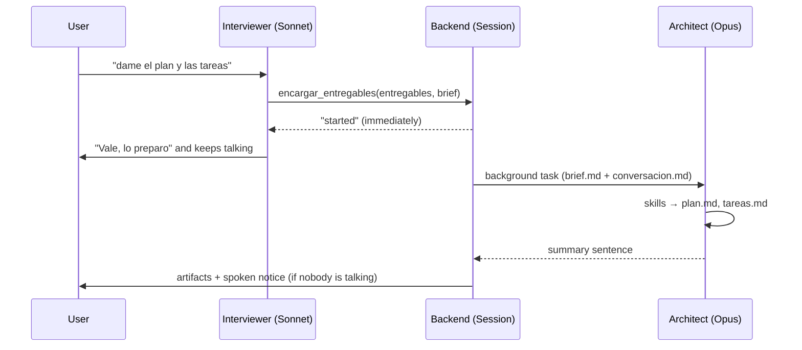

# Agent — `agent.md`

Prometeo is **two agents** that the user perceives as one:

| Agent | File | Default model | What it does |
|---|---|---|---|
| **Interviewer** | `agent/agent.md` (+ `agent/mcp-catalog.md`) | Sonnet, effort `low` | Talks to the user: asks, gathers information, suggests MCP connections and hands off the deliverables. Writes no files |
| **Architect** | `agent/arquitecto.md` | Opus, effort `high` | In the background: reads the brief and `conversacion.md`, analyses in depth and writes the deliverables with the skills |

This note mostly describes the interviewer: `agent.md` is its *system prompt* and its frontmatter feeds `/api/state`. The prompt itself is in Spanish.

| Field | Value |
|---|---|
| Name | **Prometeo** (changed in `agent.md`) |
| Role | Planning interviewer («Entrevistador de planificación») |
| Purpose | Turn a fuzzy idea into an actionable plan in as few turns as possible |
| Personality | Direct, calm, slightly futuristic, no filler or flattery |
| Manner | Informal "tú", restates in one sentence what it understood, respectfully challenges weak assumptions |

## Introduction on a new chat
A new project opens with a fixed greeting (`GREETINGS["nuevo"]` in `backend/app/main.py`, spoken via `say()` without going through Claude): Prometeo says its name, what it does (asks the right questions and prepares plan, tasks, prompt or notes) and asks what to plan. `agent.md` has a «Presentación» section telling the interviewer it has already introduced itself, so it does not repeat it. Resumed projects keep the short «Retomamos «{title}»» greeting.

## 5-phase method
1. **Goal**: what is to be achieved and for whom.
2. **Context and constraints**: time, budget, technology, people.
3. **Scope**: what's in and what's out.
4. **Risks and decisions**: what can fail and what must be decided.
5. **Wrap-up**: ask which deliverables are wanted and hand them to the Architect with `encargar_entregables`.

## Good questions
- First, whatever **changes the plan most** (real deadline, for whom, what already exists, what failure looks like).
- Concrete questions with options over generic open ones.
- Don't ask what was already said or what can be assumed with a sensible default.

## MCP connections
The interviewer suggests MCP servers useful for the project (GitHub, Figma, Postgres, Linear…), **only from the catalog** `agent/mcp-catalog.md` so it never invents names, in one sentence and at most one per turn. Suggestions go into the brief, and the Architect includes them in `plan.md` (section «Conexiones MCP recomendadas») and in `prompt.md`.

## Handoff to the Architect
- Own MCP tool `mcp__prometeo__encargar_entregables` with `entregables` (`prompt` · `plan` · `tareas` · `notas`) and `brief` (dense summary of what was gathered). Returns **immediately**.
- The backend saves the brief to `brief.md` (hidden in the panel) and launches the Architect as a separate `ClaudeSDKClient` (`run_architect` in `brain.py`).
- One handoff at a time per project; if one is already running, the interviewer says so.
- When done: `artifacts` event, and Prometeo announces it aloud if nobody is speaking. If a turn is in progress, the notice reaches the interviewer as a `[sistema: …]` note on the next message.

## Voice rules
- 1–3 sentences per turn and at most 2 questions.
- Never read code, long lists or document contents aloud.

## Security
- Interviewer: `Read`, `Glob` and `encargar_entregables`. Doesn't write.
- Architect: `Read`, `Write`, `Edit`, `Glob`, `Skill`. No Bash.
- Both with `cwd` in `projects/<slug>/` and a `PreToolUse` hook that blocks access outside that folder.
- The interviewer resumes its `session_id` from `meta.json`; the Architect starts a fresh session on every job and works from the files on disk (see [[10 Implementation decisions#Architect token usage (2026-11-10)]]).

Related: [[05 Skills]] · [[10 Implementation decisions]] · [[PROMETEO]]
